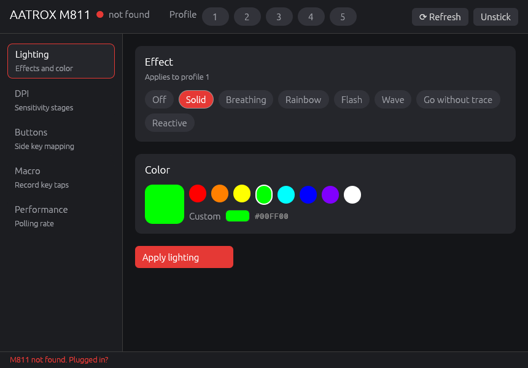

# m811



Small desktop app to control the Redragon M811 Aatrox mouse (USB 04D9:FC6D) without
the vendor app. Rust, two dependencies: `eframe` (window) and `hidapi` (USB).

Protocol was worked out from USB captures of the vendor app. See [PROTOCOL.md](PROTOCOL.md).
Every packet the app sends is a copy of what the tested Python tool in `tools/m811.py`
sends. Unit tests check the bytes match.

## What it does

- Switch profile 1-5
- Lighting per profile: off, solid, breathing, rainbow, flash, wave, go without trace, reactive
- Poll rate 500 / 1000 Hz (profile 1)
- DPI stages 1-5 (profile 1, only DPI values seen in captures)
- Remap side keys 1-8 to a letter, digit or volume up (profile 1)
- Write macro slot 1 and bind it to a side key

Safety:

- Macro slot 0 is never written. A side key bound to slot 0 shows as locked.
- Every config-mode write ends with "config mode off", even on errors.
  If the mouse ever stops moving, press **Unstick**.

## Command line and config files

```
m811 status > my.cfg      # current settings, as a config file
m811 apply my.cfg         # write them back
m811 led 1 solid ff0000   # one change
m811 help
```

Paste into any LLM (ChatGPT, Claude, ...) to get commands for what you want:

```
m811 prompt | clip        # copies docs/LLM-PROMPT.md + your current settings
```

## Per-game profiles and tray

`m811 tray` puts an icon in the system tray. Every 2 seconds it checks which program is
in front and runs the matching block from `%APPDATA%\m811\games.cfg`:

```
game valorant.exe
led 2 solid ff0000
profile 2

default
profile 1
```

Edit it on the **Games** page in the window, or from the tray menu. The tray menu and the
Games page both have **Start with Windows** (adds `m811 tray` to your startup programs).

Built so an LLM agent can drive it. See [AGENTS.md](AGENTS.md) and
[docs/llm-control.md](docs/llm-control.md).

## Get it

Download `m811-windows` from the latest
[build run](../../actions/workflows/build.yml), unzip, run `m811.exe`.

Or build it yourself:

```
cargo build --release
target\release\m811.exe
```

## Code

- `src/proto.rs` packet builders, no I/O, with tests
- `src/mouse.rs` HID open / read / send
- `src/cli.rs` command line and config files, with tests
- `src/games.rs` per-game rules, with tests
- `src/tray.rs` Windows tray icon, front-window watcher, start with Windows
- `src/main.rs` the window
